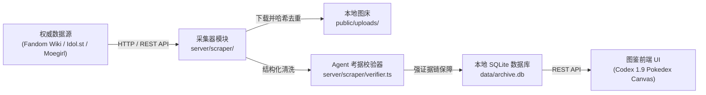

# 0002 - 自动化衣装图鉴采集与考据流水线实施计划

## 1. 架构与技术选型

- **采集模块**：基于 TypeScript / 原生 `fetch` 构建，接入 Fandom Wiki MediaWiki API 与 Idol Story 结构化数据源。
- **图片持久化**：使用 Node.js 流式下载直接存入 `public/uploads/`，结合 MD5/SHA256 哈希或官方资源 ID 实现 100% 本地去重。
- **校验闸门**：入库前对日文官方名、卡面形态、来源 URL 格式执行断言，保障权威性。
- **图鉴前端增强**：保留 Codex 1.9 单画布舞台与胶卷交互，强化“全收集度计数（Completion Rate）”与“出处形态过滤（卡面觉醒前/后、Live 舞台等）”。

---

## 2. 实施分步计划

### 阶段一：采集器核心与数据源适配 (Scraper Core)
- `server/scraper/types.ts`：定义采集标准实体（角色映射、衣装日文名、出处、卡面形态、大图 URL、证据外链）。
- `server/scraper/downloader.ts`：实现流式断点续传、本地去重与图片类型检测。
- `server/scraper/sources/fandom.ts` & `idolstory.ts`：实现虹咲、Liella!、Aqours、μ's、莲之空的衣装与卡面解析。

### 阶段二：Agent 考据校验与入库持久化 (Ingestion & Verification Gate)
- `server/scraper/curator.ts`：编排抓取、下载、考据检验、SQLite 事务入库。
- `package.json`：注册 `pnpm run curate` CLI 命令，支持按角色/团体灵活触发。

### 阶段三：图鉴前端优化与“一键扩充图鉴”体验 (Pokedex Experience)
- 强化每位角色与各团体的图鉴收录进度（如 `三船栞子：18 / 35 套收录`）。
- 界面内提供直接触发或查看抓取日志的快捷入口。
- 精细化卡面形态徽章（觉醒前/特训前、觉醒后/演出服、Live 现场服）。

### 阶段四：验证与测试
- 编写自动化测试 `tests/test-curation.ts` 覆盖 AC-1 至 AC-8。
- 实际拉取三船栞子及其他角色的全套真实官方衣装数据并核验。
